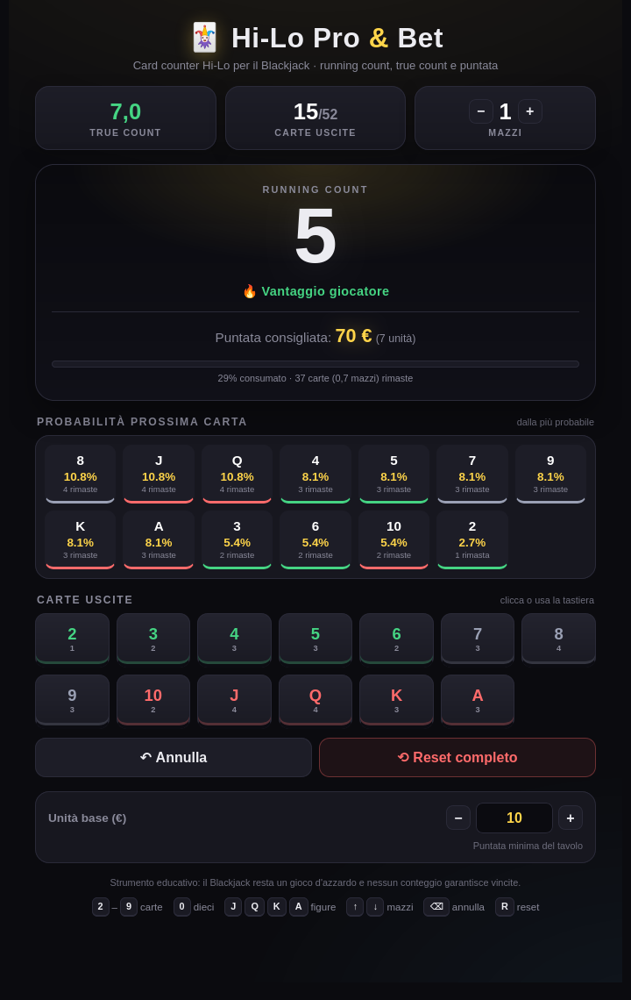

# 🃏 Hi-Lo Pro & Bet

Card counter per il **Blackjack**, leggero e senza dipendenze: HTML5, CSS3 e JavaScript puro.
Tiene il **Running Count** con il sistema **Hi-Lo**, calcola il **True Count** e suggerisce la puntata in base al vantaggio stimato, con supporto da 1 a 8 mazzi.

> ⚠️ Strumento educativo. Il Blackjack è un gioco d'azzardo: il conteggio delle carte non garantisce vincite.



## ✨ Funzionalità

- **Conteggio Hi-Lo in tempo reale** — carte 2–6 `+1`, 7–9 `0`, 10/J/Q/K/A `−1`.
- **True Count automatico** — Running Count diviso i mazzi effettivamente rimanenti.
- **Bet Manager** — puntata consigliata in unità e in euro, con soglia di vantaggio.
- **Probabilità della prossima carta** — tutte le 13 carte ordinate per probabilità, con quante copie restano.
- **Barra di penetrazione** — percentuale del mazzo consumata e carte rimaste.
- **Annulla ultima carta** — niente panico se si sbaglia un tasto.
- **Salvataggio automatico** — conteggio, mazzi e unità base restano anche dopo un refresh (`localStorage`).
- **Multi-mazzo** — da 1 a 8 mazzi, con reset automatico del conteggio al cambio mazzo.
- **Responsive e accessibile** — layout mobile-first, focus visibile, etichette ARIA e rispetto di `prefers-reduced-motion`.
- **Nessuna dipendenza** — basta aprire `index.html`.

## 🚀 Come utilizzarlo

### In locale

1. Scarica o clona la repository.
2. Apri `index.html` nel browser.

In alternativa, se preferisci servirlo via HTTP:

```bash
python3 -m http.server 8000
# poi apri http://localhost:8000
```

### GitHub Pages

Nelle impostazioni della repository: **Settings → Pages → Deploy from a branch → `main` / root**.
L'app è statica e non richiede build.

## ⌨️ Scorciatoie da tastiera

| Tasto | Azione |
| :--- | :--- |
| **2 – 9** | Registra una carta di valore 2–9 |
| **0** | Registra un dieci |
| **J, Q, K** | Registra una figura (−1) |
| **A** o **1** | Registra un asso (−1) |
| **↑ / ↓** | Aumenta / diminuisci il numero di mazzi (1–8) |
| **⌫ Backspace** o **Canc** | Annulla l'ultima carta |
| **R** | Reset completo del conteggio |

Le scorciatoie sono disattivate mentre si scrive nell'input dell'unità base.

## 📐 Come funziona

### Sistema Hi-Lo

| Carte | Valore Hi-Lo |
| :--- | :---: |
| 2, 3, 4, 5, 6 | **+1** |
| 7, 8, 9 | **0** |
| 10, J, Q, K, A | **−1** |

Il **Running Count** è la somma dei valori Hi-Lo di tutte le carte uscite.

### True Count

```text
True Count = Running Count / mazzi rimanenti
mazzi rimanenti = carte rimanenti / 52
```

Il True Count viene mostrato con un decimale e normalizzato a `0,0` quando è vicino allo zero.

### Bet Manager

La puntata si basa sul True Count:

| True Count | Puntata consigliata |
| :--- | :--- |
| **< 1,5** | 1 unità base (puntata minima) |
| **≥ 1,5** | `max(1, floor(TC))` unità base |

Esempio: con unità base da 10 € e True Count `3,2`, la puntata suggerita è `3 × 10 € = 30 €`.

La soglia di vantaggio è indicata anche a livello visivo:

- **TC ≥ 2** → vantaggio giocatore
- **1,5 ≤ TC < 2** → vantaggio lieve
- **−1 < TC < 1,5** → tavolo neutro
- **TC ≤ −1** → banco favorito

## 🗂️ Struttura del progetto

```text
hi-lo-counting/
├── index.html          # Struttura dell'interfaccia
├── style.css           # Tema scuro, layout responsive
├── script.js           # Conteggio, statistiche, probabilità, bet manager
├── docs/
│   └── screenshot.png  # Anteprima dell'interfaccia
└── README.md
```

## 💾 Dati salvati

L'app salva in `localStorage` (chiave `hilo-pro-v1`):

- numero di mazzi;
- unità base;
- carte giocate;
- cronologia per l'undo.

Il pulsante **Reset completo** azzera conteggio e cronologia, ma mantiene mazzi e unità base.
Per ripartire da zero anche con le impostazioni, cancella i dati del sito dal browser.
